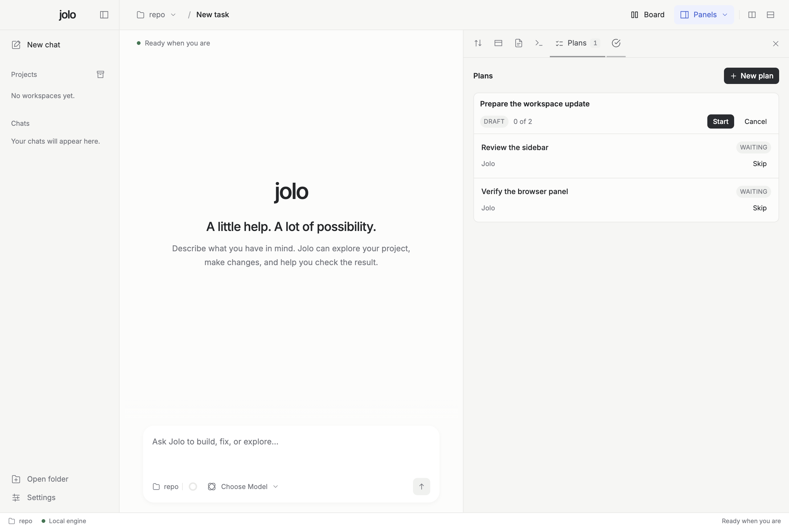
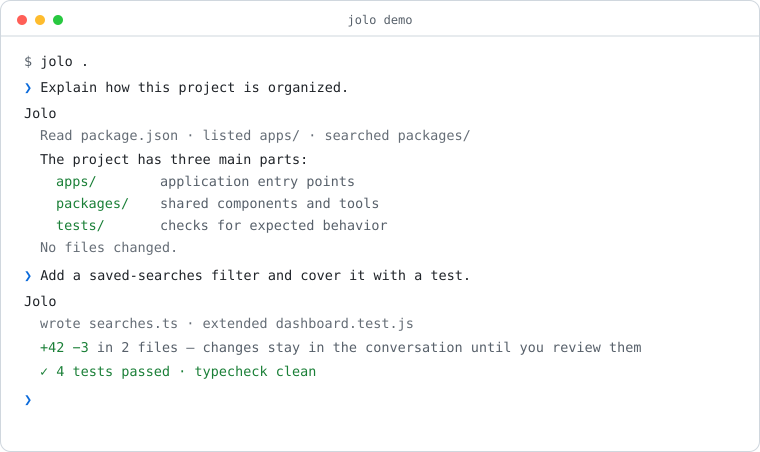

# Jolo

[](https://github.com/jolo-build/jolo/releases/latest)
[](https://github.com/jolo-build/jolo/actions/workflows/typecheck.yml)
[](LICENSE)

A desktop app and CLI for working with coding agents.

Use Claude Code, Codex, Devin CLI, Grok CLI, Gemini CLI, or your own API provider. Keep your chats, files, terminal, and browser in one workspace.

[Download](https://github.com/jolo-build/jolo/releases/latest) · [Website](https://jolo.build) · [User guide](https://docs.jolo.build) · [Report a bug](https://github.com/jolo-build/jolo/issues)

<picture>
  <source media="(prefers-color-scheme: dark)" srcset="assets/screenshots/jolo-desktop-dark.png">
  <source media="(prefers-color-scheme: light)" srcset="assets/screenshots/jolo-desktop-light.png">
  
</picture>

## What you can do

- Ask an agent to explain code, build a feature, or fix a bug.
- Review changes and run checks beside your chat.
- Open files, a terminal, and a browser without leaving the app.
- Work on several tasks at once, with split views and separate Git worktrees.
- Create a plan, choose an agent for each step, and run the steps in order.
- Type `^` to choose a model for a child task, such as an independent review or investigation.
- Give a task a heartbeat — a prompt that returns on an interval to check on delegated work.
- Attach files and explore diagrams and interactive visualizations.

## Install

**Desktop:** Download the archive for your platform from [GitHub Releases](https://github.com/jolo-build/jolo/releases/latest):

- **macOS** (`.dmg`, Apple Silicon and Intel): open it and drag Jolo into Applications. With Homebrew: `brew install --cask jolo-build/tap/jolo`.
- **Windows** (`.zip`, x64): unpack it and run `Jolo.exe` inside.
- **Linux** (`.tar.gz`, x64 and ARM64): unpack it and run `./Jolo-linux-*/Jolo`.

Jolo is in early development. The macOS app is not yet notarized, Windows and Linux builds are unsigned, and automatic updates are not available.

**CLI:** Run this in your terminal:

```sh
curl -fsSL https://jolo.build/install.sh | bash
```

Or with Homebrew: `brew install jolo-build/tap/jolo-cli`.

Or install the `jolo-cli` package with Bun:

```sh
bun add -g --trust jolo-cli
jolo --version
jolo .
```

`--trust` allows Jolo's postinstall script to download and verify the CLI binary. If you need Bun on macOS, run `curl -fsSL https://bun.sh/install | bash`, then restart your terminal before installing Jolo. See the [Bun installation guide](https://bun.com/docs/installation).

This installs the CLI, not the desktop app. CLI packages are available for macOS and Linux, on ARM64 and x64.

Want a look first? `jolo demo` plays a scripted session — no agent or account needed:

<picture>
  <source media="(prefers-color-scheme: dark)" srcset="assets/brand/demo.svg">
  <source media="(prefers-color-scheme: light)" srcset="assets/brand/demo-light.svg">
  
</picture>

## Start a task

1. On your first launch, follow the guide to choose an agent, open a folder, and prepare a first task. You can skip it and reopen it from **Getting started** on the work board.
2. Choose an agent and model below the message box.
3. Describe what you want to do.
4. Review the agent's work and continue the conversation.

The guide opens suggested tasks as editable drafts. Review the message and press Send when you are ready. You can also start a new chat without a project folder.

Install and sign in to your coding agent separately before using it in Jolo. You can also configure an API provider.

For Devin, install the [Devin CLI](https://docs.devin.ai/cli/acp/zed) and sign in with `devin auth login`. Restart Jolo, then choose **Devin CLI** or mention `@devin` in chat. Jolo uses your existing local CLI login and reads the available models from Devin.

Prefer the terminal? Open a project with:

```sh
jolo /path/to/project
```

Or run a single task:

```sh
jolo run --agent claude "Explain this repository" --path /path/to/project
```

See the [CLI guide](apps/cli/README.md) for more commands.

## Delegate to a model

<picture>
  <source media="(prefers-color-scheme: dark)" srcset="assets/brand/model-mentions-dark.svg">
  
</picture>

In desktop or the terminal UI, type `^` in your message and choose a model, its agent or API provider, and an optional effort level. Ask your current agent what to delegate—for example, “Ask this model to review the diff.” The selection makes that exact model available for child tasks without changing who answers the main conversation.

Selected models remain available in the conversation. Each child has its own conversation in the same workspace; the parent can collect its response and summarize it. Desktop shows child-task status with controls to open or stop each child. In the CLI, `/sessions` opens child conversations. Stopping the parent also stops its active children. A turn supports up to four active children, and children cannot create further children.

## Chat navigation

On a Mac, swipe with two fingers horizontally over the conversation, empty message box, header, or sidebar to move through all open chats and tasks in the same order as the task rail, including chats you haven’t visited yet. Swiping changes only the active split pane. Swipe left to move up the rail and right to move down; Jolo follows your Mac’s Natural Scrolling setting. A floating preview shows the destination chat and your swipe progress. Navigation stops at either end of the rail. The main pane’s selected chat survives a desktop reload. Scrolling code or tables and pinching to zoom keep their usual behavior. Swipes are disabled while you have an unsent draft or attachment.

## Appearance

In the desktop app, open **Settings → Appearance → Color theme**, choose a palette, and click **Save changes**. The desktop shares the CLI’s neutral Jolo White theme, four Catppuccin palettes (Latte, Frappé, Macchiato, Mocha), and three GitHub palettes (Light, Dark, Dark Dimmed). **System default** follows your computer’s light or dark appearance.

The choice is remembered on this device and applies to the interface, code highlighting, diffs, and terminal panes. Desktop and CLI selections are independent.

## Web tasks

[Jolo Access](https://access.jolo.build) lets you manage personal and team tasks in your browser. Sign in to connect them to the desktop or CLI, then type `#` in chat to reference a task.

An account is optional. You can use Jolo locally without one.

## Run from source

Install the Bun version in [.bun-version](.bun-version), then:

```sh
git clone https://github.com/jolo-build/jolo.git
cd jolo
bun install --frozen-lockfile
bun run desktop
```

For the CLI, use `bun run jolo`. See [local CLI development](apps/cli/README.md#local-development) to rebuild and install your changes.

## Contribute

Bug reports and pull requests are welcome. Read [CONTRIBUTING.md](CONTRIBUTING.md) for development setup and checks, or [SECURITY.md](SECURITY.md) to report a vulnerability.

## Community

- [GitHub issues](https://github.com/jolo-build/jolo/issues) — questions, ideas, and bug reports.
- [ROADMAP.md](ROADMAP.md) — where the project is heading.
- [CHANGELOG.md](CHANGELOG.md) — what changed in each release.

## License

[MIT](LICENSE). Fonts, [agent icons](assets/brand/agents/LICENSE), and optional components in `vendor/` keep their own licenses.

### Decision models alongside a chat model

For a direct TypeSafe API key, choose **Jev (TypeSafe)** in provider settings, save the key, then select **Jev Latest** or **Jev Preview** in the chat's model picker. You can also store it with `jolo auth set typesafe` (reads stdin), or set `TYPESAFE_API_KEY` in the engine environment. Jolo discovers models from TypeSafe and sends requests directly to `https://api.typesafe.ai/v1/systemone`; this connection does not use OpenRouter. Direct Jev selections start in **Browser** mode and are saved per chat. TypeSafe accepts pinned model IDs as well as the discovered aliases. Jev returns typed decisions, not generated prose; **Chat** mode requires a companion text model as described below. See the [TypeSafe API reference](https://docs.typesafe.ai/api).

For a model that reports decision output (such as OpenRouter → Jev), select a text model first and then the decision model. Jolo keeps the text model for conversation and lets it call the decision model for structured choices. Normal messages such as “hi” go to the text model; you do not need to write JSON. The pairing is saved per chat. Existing decision-model chats without a pairing use the configured default text model. If no text model is configured, select one before adding the decision model. For direct decisions, **Example** supplies `state` and typed `questions` (`noul`, `choice`, `score`); these requests go straight to the decision model and display its answers and probabilities. Decision-only models do not generate prose or code. Each provider bills its own requests.

For direct browser use, select the decision model and choose **Browser** in the composer. This mode calls only the selected decision model. Jolo supplies accessibility text and a set of valid actions, executes the chosen action through its regular browser tools, and reads the page again. Supply a URL or describe the resource to find; Jev can open web search when the destination is unknown. Jev selects exact spans from your instruction for each field, without command-word rules or mandatory quotation marks. Bare domains are accepted. For example: `Open example.com/search and find coffee.` It supports navigation, scrolling (including scrollable regions), clicks, filling supplied text, Enter, back, and waiting. For requests such as “list all exhibitors,” it can read beyond the first snapshot, select matching text with typed decisions, collect entries across scrolling and pagination, and return a deduplicated list with source URLs. Collected entries survive pauses and resumes. Results identify partial collections and do not claim independently verified coverage of the whole site. It cannot interpret screenshots or generate new form text. It pauses when blocked or repeatedly making no progress; resumed runs inspect the current page before acting. Like other browser tasks, it requires the Jolo desktop browser host.
